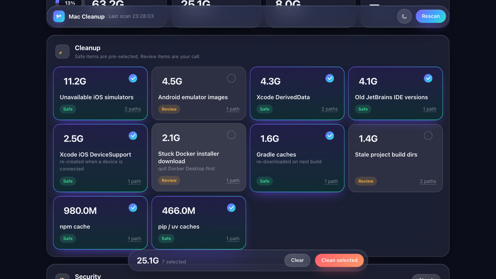

# Mac Cleanup

**Clean, monitor and secure a macOS development machine. Native app, web UI or CLI.**

Dev Macs pile up gigabytes of rebuildable junk: Xcode DerivedData, orphaned iOS simulators, old IDE versions, and npm, Gradle, Cargo and pip caches, plus stale `node_modules`. They also tend to have services quietly open to the network. Mac Cleanup (CLI name `macguard`) finds both, explains what it found, and fixes it only when you ask.

- **Disk cleanup**: sizes up junk by category. Each category is marked **safe** (caches that regenerate) or **review** (your call). It deletes nothing without confirmation, and only inside your home folder.
- **Security audit**: firewall and stealth mode, SIP, Gatekeeper, FileVault, Screen Sharing and SSH, launch agents and daemons (unsigned or orphaned), and private keys left in Downloads, Desktop or Documents.
- **Apps and traffic**: flags installed apps with broken or missing signatures, outdated, end-of-life or remote-access apps and orphaned root helpers, and samples live traffic per process to spot heavy uploads, scanning or odd destinations.
- **Network analysis**: every listening port with its owning binary and code signature, connections by process, gateway, DNS and ARP. Flags exposed services, known-bad ports, unsigned programs, inbound scans and ARP spoofing.
- **Network monitor**: records every connection (program → IP:port, bytes) into a day-by-day history, names the IPs by reverse DNS, and warns about risky traffic: suspicious ports, unsigned or temp-folder programs online, inbound connections, unencrypted protocols, new destinations.
- **Heavy processes**: lists what is eating CPU or memory and says which are safe to stop. macOS, root-owned and the session's own processes are never killed.
- **MCP server**: exposes all of it to AI clients such as Claude (`macguard mcp`).
- **Watcher (opt-in)**: alerts on new open ports, gateway MAC changes, DNS or `/etc/hosts` changes. Off by default.
- **Three front ends**: a native **Mac Cleanup.app**, a local **web UI** with a glass design, and the **`macguard` CLI**.

Standard-library Python plus a small Swift wrapper. No root, no telemetry, nothing leaves your Mac.



## Quick start

```bash
git clone https://github.com/prateekx8/mac-cleanup.git
cd mac-cleanup
./setup.sh                      # checks prerequisites, installs `macguard`, runs the tests
./build_app.sh --install        # optional: native Mac Cleanup.app in /Applications
```

Requirements: macOS 13 or later, plus Apple's Command Line Tools (`xcode-select --install`) for `/usr/bin/python3` and `swiftc`.

| I want… | Do this |
|---|---|
| The app | `./build_app.sh --install`, then open **Mac Cleanup** from Applications (or use `dist/MacCleanup.dmg`) |
| One-click setup and the UI | Double-click **`MacCleanup.command`** in Finder |
| The CLI | `./setup.sh`, then open a new terminal and run `macguard --help` |

`setup.sh` checks prerequisites (macOS, Apple's Command Line Tools for `/usr/bin/python3`, system tools), installs the `macguard` command into `~/.local/bin`, runs `macguard doctor` and the test suite. It's safe to re-run. `./setup.sh --uninstall` removes everything.

## CLI

| Command | What it does |
|---|---|
| `macguard scan` | Disk junk analysis. Read-only. |
| `macguard clean` | Dry run of the **safe** cleanup. |
| `macguard clean --apply` | Delete safe items after you type `yes`. |
| `macguard clean --only android-avd,project-artifacts --apply` | Clean specific **review** items. |
| `macguard security` | Security posture audit. |
| `macguard net` | Network snapshot and threat findings. |
| `macguard apps [--online] [--list]` | Installed apps: broken or missing signatures, outdated (Homebrew), end-of-life or risky software, Intel-only, orphaned root helpers, system extensions. `--online` also checks Apple for macOS updates. |
| `macguard traffic [--seconds 8]` | Samples live traffic per process: heavy uploads, outbound scanning, unsigned or temp-folder programs online, odd ports. |
| `macguard netmon [--interval 5] [--seconds N]` | Record connections into `~/.macguard/netlog.db` until Ctrl-C. |
| `macguard netlog [--days 7] [--proc NAME]` | Network history: connections per day, top programs and destinations (with names, ports, days seen), and risky-traffic findings. |
| `macguard procs [--cpu 30] [--mem-mb 1024]` | Heavy processes, classed **system** (never killed), **app** (quit the app instead) or **background** (safe for macOS to stop). |
| `macguard procs --kill <pid> [--force]` | Stop one non-system process after you type `yes` (SIGTERM, or SIGKILL with `--force`). |
| `macguard mcp` | MCP server on stdio for AI clients. See below. |
| `macguard watch` | Monitor in the foreground until Ctrl-C (`--once`, `--reset`). |
| `macguard ui` | Local web UI at `http://127.0.0.1:8787`. |
| `macguard report` | Static HTML report in `~/.macguard/report.html`. |
| `macguard settings [key value]` | `background_watcher on/off` (off by default), `watch_interval <sec>`. |
| `macguard doctor [--bundle]` | Check prerequisites and optionally write a support file. |

## MCP server

`macguard mcp` (or `macguard_mcp.py`) is a Model Context Protocol server on stdio, so Claude and other MCP clients can run the checks for you. Add it to Claude Code:

```bash
claude mcp add mac-cleanup -- /usr/bin/python3 /path/to/mac-cleanup/macguard.py mcp
```

| Tool | What it does |
|---|---|
| `disk_info`, `scan_junk` | Free space and junk by category. Read-only. |
| `plan_cleanup` | Dry run: the exact paths that would go, plus a `plan_id`. Safe categories by default, review ones only by id. |
| `apply_cleanup` | Deletes only the paths in that plan, needs `confirm: true`, and each plan works once (15 min). |
| `process_check` | Heavy CPU/memory processes with `kind` and `killable`. Read-only. |
| `kill_process` | Stops one non-system process. Needs the `exe` path from `process_check` (guards against pid reuse) and `confirm: true`. |
| `security_audit`, `network_snapshot`, `apps_audit`, `traffic_sample` | The same audits as the CLI. Read-only. |
| `network_history` | Recorded connections over N days: per day, top programs, top destination IPs with names. Read-only. |
| `network_alerts` | Risky traffic found in that history. Read-only. |
| `network_record` | Sample connections now for a few seconds and add them to the history. |
| `network_monitor_status` | Whether the background recorder runs and how many days are recorded. |
| `doctor`, `recent_events` | Prerequisites, and the event log with settings. |

`apply_cleanup` and `kill_process` are marked destructive, so clients ask before running them. The server is standard-library Python like the rest.

## Network monitor

To keep a history all the time, turn on the background watcher (off by default):

```bash
macguard settings background_watcher on
```

It records the connection table every 10 seconds and keeps 90 days. It reads the kernel's socket table, so it needs no root and sends nothing anywhere. Closed TCP connections stay visible for about 30 seconds (`TIME_WAIT`), so most short requests are caught too. Limits: it sees IP addresses, not the domain names a program asked DNS for, so names come from reverse DNS and many IPs have none. Long IPv6 addresses of root-owned processes stay shortened because netstat cuts them.

## Development

```bash
/usr/bin/python3 -m unittest discover -s tests -v   # 102 tests
./build_app.sh                                      # dist/Mac Cleanup.app + dist/MacCleanup.dmg
```

Unit tests run against temporary directories and mocked system commands. They never touch your real caches, settings or launch agents. The `LiveSystem` tests make read-only calls to macOS.

## Docs

- [Architecture](docs/ARCHITECTURE.md): components, data flow, UI security model, app process model, with a [diagram](docs/architecture.png)
- [Support and troubleshooting](docs/SUPPORT.md)

## Notes

- It always runs under Apple's `/usr/bin/python3`. On recent macOS other interpreters, and the children of ad-hoc signed apps, can't see other processes' sockets. The app runs its engine as a short-lived launchd job for the same reason.
- Network detection uses heuristics over the kernel's socket table, not packet inspection. For per-app outbound blocking, pair it with a firewall such as LuLu.
- The app is ad-hoc signed for local use. To distribute it more widely, sign it with a Developer ID and notarize it.

## License

[MIT](LICENSE). The narration in the demo videos uses Kokoro-82M (Apache-2.0). The videos show demo data only.
