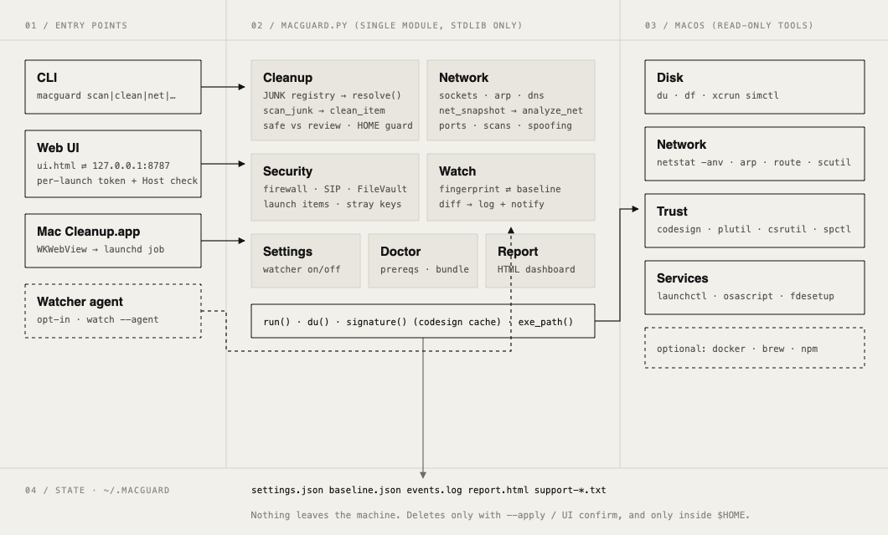
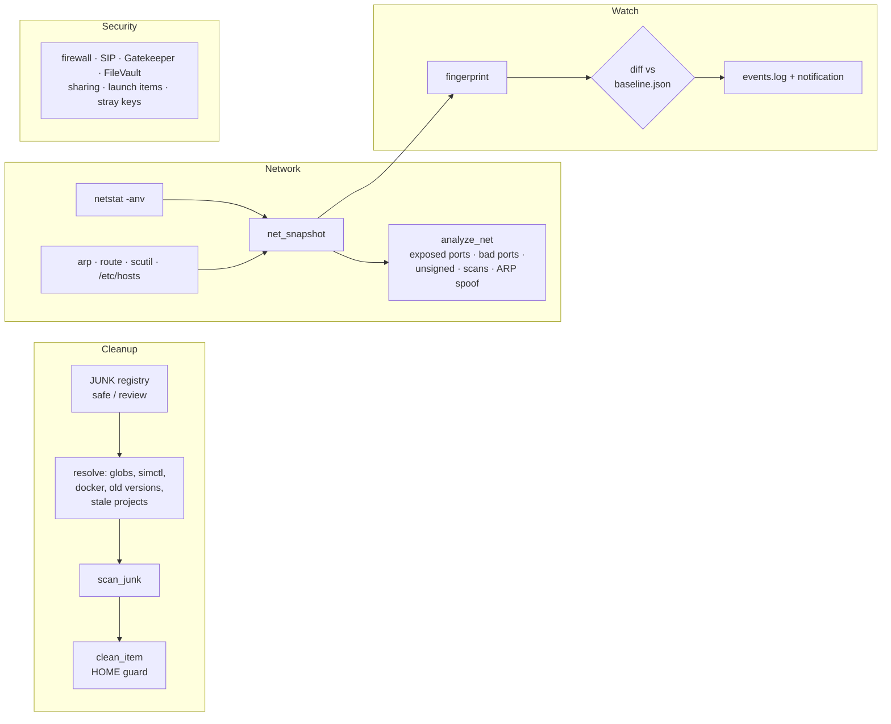
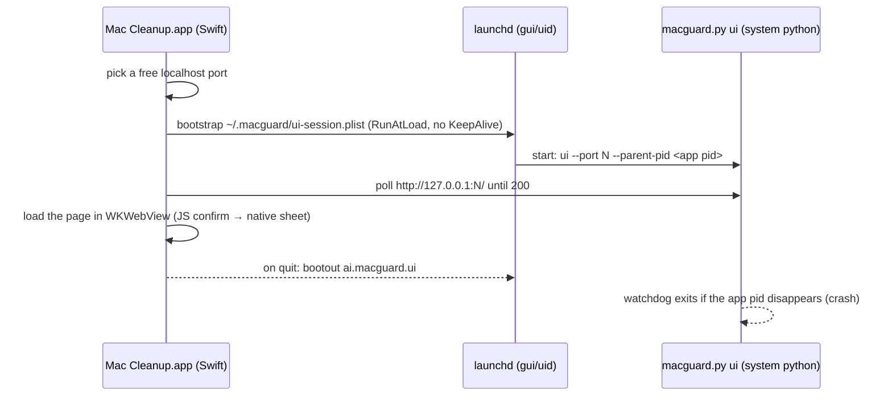

# Architecture

([SVG version](architecture.svg), which adapts to light and dark themes.)

mac-cleanup is one Python module (`macguard.py`, standard library only) with four ways in: the CLI, a local web UI, a native macOS app, and an opt-in background watcher. Every feature calls read-only macOS tools and keeps its state in `~/.macguard`. Nothing is sent off the machine.

## Components

| Part | File | Responsibility |
|---|---|---|
| Engine and CLI | `macguard.py` | All logic, plus the `argparse` subcommands (`scan`, `clean`, `net`, `security`, `watch`, `report`, `settings`, `ui`, `doctor`). |
| Web UI | `ui.html` | A single page with vanilla JS and glassmorphism styling. It talks to the engine's JSON API. |
| Native app | `app/main.swift` | An AppKit window with a `WKWebView`. It starts the engine and shows the UI. |
| App icon | `app/make_icon.swift` | Draws the original icon (gradient squircle with a sparkle) at build time. |
| Packaging | `build_app.sh` | Builds a universal `Mac Cleanup.app` (arm64 + x86_64), ad-hoc signs it, and makes a DMG. |
| Setup | `setup.sh`, `MacCleanup.command` | Checks prerequisites, installs the `macguard` command, runs `doctor` and the tests. |
| Tests | `tests/test_macguard.py` | 58 tests: unit tests on temp dirs and mocked system calls, plus live read-only checks. |

## Engines inside `macguard.py`

### Cleanup

- `JUNK` is a declarative list. Each entry has an `id`, a `risk` (`safe` or `review`), and either glob `paths` or a `special` resolver (`simctl`, `docker`, `jetbrains`, `ndk`, `projects`, `downloads`).
- **Safe** items are caches that rebuild themselves. **Review** items need your decision.
- Project build folders only count when the project hasn't been edited for `--stale-days`. `build` and `dist` count only next to a matching build file, and `target` only next to `Cargo.toml` or `pom.xml`.
- `clean_item` refuses any path outside `$HOME` or shallower than four levels. Where a tool has its own cleanup command (`xcrun simctl delete unavailable`, `docker system prune`, `npm cache clean`, `brew cleanup`), that command is used.

### Network

- `netstat -anv` lists every process's sockets without root. Process paths come from `ps`, and trust comes from `codesign` (cached per binary).
- Heuristics flag:
  - well-known services exposed beyond loopback (Redis, Docker API, VNC, AirPlay and so on)
  - known-bad ports
  - unsigned or temp-folder binaries
  - many connections from one remote address (a likely scan)
  - a gateway MAC address shared with another IP (ARP spoofing)
- **Limitation:** this inspects socket tables, not packets.

### Watch

- `fingerprint()` reduces a snapshot to listeners (ephemeral ports collapsed to `dyn`), programs talking to the internet, the gateway MAC, DNS servers and `/etc/hosts`.
- Each tick it diffs against `baseline.json`, logs new items, sends a macOS notification for medium and high events, and then folds them into the baseline so the same event doesn't alert twice.

## Web UI security

The UI server binds to **127.0.0.1 only**. Every API call needs:

1. a **per-launch random token**, embedded in the page and sent as `X-Token`, so other websites can't call the API (CSRF), and
2. a `Host` header of `127.0.0.1:<port>` or `localhost:<port>`, which blocks DNS-rebinding attacks.

`/api/clean` only accepts category ids from the most recent scan. It never takes paths from the client.

## Native app process model

**Why launchd instead of a child process?** On recent macOS a process only sees other processes' sockets if the system trusts the process responsible for it. The children of an ad-hoc signed app inherit its restrictions and see 0 sockets. Even "disclaiming" responsibility with `posix_spawn` didn't help. A launchd job running Apple's `/usr/bin/python3` sees everything, just like running from Terminal. The same reason explains why the CLI re-runs itself under `/usr/bin/python3` when started from Homebrew or pyenv Python.

## State (`~/.macguard`)

| File | Written by |
|---|---|
| `settings.json` | `settings`, the UI toggle |
| `baseline.json` | `watch` |
| `events.log` | `watch`, `clean` |
| `report.html` | `report` |
| `support-*.txt` | `doctor --bundle` |
| `app.log`, `ui-session.plist` | the native app |

## Design decisions

- **Standard library only.** Nothing to install or audit, and it runs on any Mac that has the Command Line Tools.
- **Dry run by default.** Deletion needs `--apply` plus typing `yes`, or a confirmation dialog in the UI.
- **The watcher is opt-in.** Nothing runs in the background or at login unless `settings background_watcher on` is set.
- **No root.** Every check works as the logged-in user.
