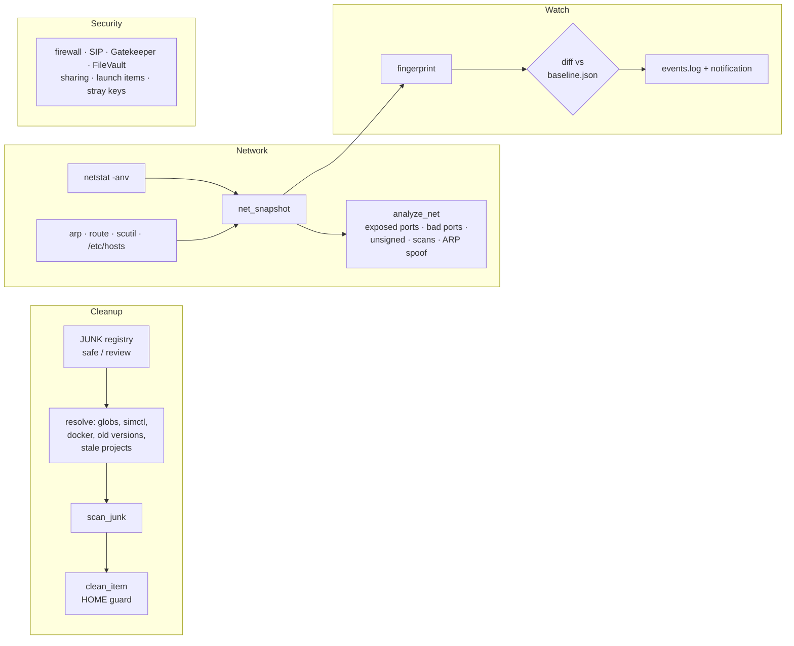
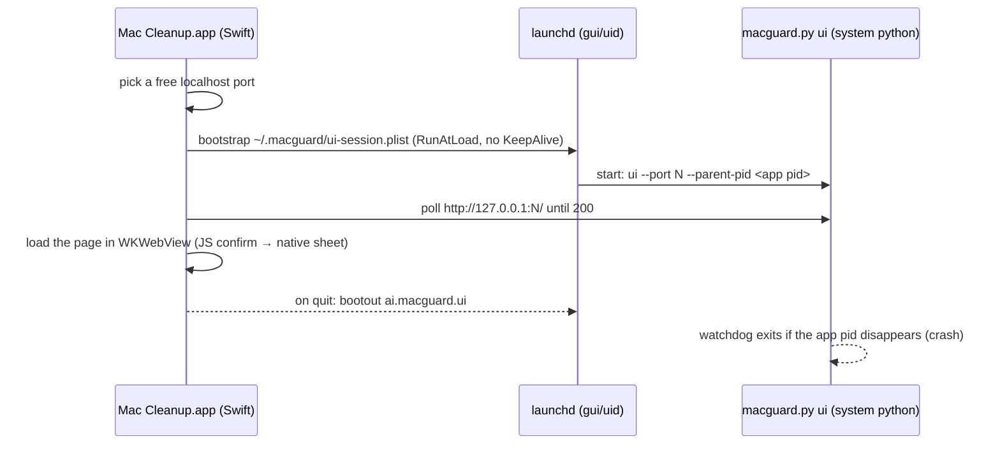

# Architecture

([SVG version](architecture.svg), which adapts to light and dark themes.)

mac-cleanup is one Python module (`macguard.py`, standard library only) with four ways in: the CLI, a local web UI, a native macOS app, and an opt-in background watcher. Every feature calls read-only macOS tools and keeps its state in `~/.macguard`. Nothing is sent off the machine.

## Components

| Part | File | Responsibility |
|---|---|---|
| Engine and CLI | `macguard.py` | All logic, plus the `argparse` subcommands (`scan`, `clean`, `net`, `security`, `apps`, `traffic`, `uninstall`, `kill`, `deepscan`, `watch`, `report`, `settings`, `ui`, `doctor`). |
| Web UI | `ui.html` | A single page with vanilla JS and glassmorphism styling. It talks to the engine's JSON API. |
| Native app | `app/main.swift` | An AppKit window with a `WKWebView`. It starts the engine and shows the UI. |
| App icon | `app/make_icon.swift` | Draws the original icon (gradient squircle with a sparkle) at build time. |
| Packaging | `build_app.sh` | Builds a universal `Mac Cleanup.app` (arm64 + x86_64), ad-hoc signs it, and makes a DMG. |
| Setup | `setup.sh`, `MacCleanup.command` | Checks prerequisites, installs the `macguard` command, runs `doctor` and a quick self-check (`--app` builds the app, `--test` runs the suite). Every failure prints a `fix:` line; output goes to `~/.macguard/setup.log`. Walkthrough: [INSTALL.md](INSTALL.md). |
| Dev session security | `macguard_devsec.py` | Network, process, persistence, sensitive-file, LuLu and npm monitors, and the session that runs them (`session`, `net --live`, `procs --tree`, `persist`, `scan-deps`, `lulu`, `alerts`). |
| Tests | `tests/test_macguard.py`, `test_mcp.py`, `test_capture.py`, `test_devsec.py`, `test_install.py` | 263 tests (all files): unit tests on temp dirs and mocked system calls, plus live read-only checks. |

## Engines inside `macguard.py`

### Cleanup

- `JUNK` is a declarative list. Each entry has an `id`, a `risk` (`safe` or `review`), and either glob `paths` or a `special` resolver (`simctl`, `docker`, `jetbrains`, `ndk`, `projects`, `downloads`).
- **Safe** items are caches that rebuild themselves. **Review** items need your decision.
- Project folders come in two kinds. **Dependencies** (`node_modules`, `.venv`, `venv`) are only offered once the project has gone stale. **Build output** (`target`, `build`, `dist`, `.next`, `__pycache__`, `.gradle`, lint and type caches, `cmake-build-*`) is also offered for active projects, through the optional `build-outputs` review check (`clean --builds`). Anything holding git-tracked files is skipped (`git ls-files`, cached once per repo), so a committed `dist/` is safe.
- Stale project folders only count when the project hasn't been edited for `--stale-days`. `build` and `dist` count only next to a matching build file, and `target` only next to `Cargo.toml` or `pom.xml`.
- `clean_item` refuses any path outside `$HOME` or shallower than four levels. Where a tool has its own cleanup command (`xcrun simctl delete unavailable`, `docker system prune`, `npm cache clean`, `brew cleanup`), that command is used.

### Docker and space insights

- Docker is split by risk. Build cache and dangling images are **safe**. Stopped containers, images no container uses, and dangling volumes are **review**, listed as `name (id)`. Cleanup removes exactly those IDs (`docker rm`, `docker rmi` and `docker volume rm` never use `--force`), so in-use objects stay. When Docker's engine isn't running, nothing is listed.
- `disk_health()`: **low** means under 10 GB or 10% free, **critical** under 5 GB or 5%. Scan and the UI show a banner, and the watcher alerts once per drop, then re-arms after recovery.
- `measure_dirs()` sizes app-data, container, dot-folder and project directories. `record_sizes()` keeps the last 30 snapshots in `~/.macguard/sizes.json`. `growth()` compares against the newest snapshot that's at least an hour old and drops a parent when a child explains the growth.
- `managed_storage()` reports large data that its owning app must remove: the Claude Cowork image, Docker's virtual disk, simulator runtimes, Ollama models, iPhone backups, Xcode archives and Time Machine local snapshots. Each comes with how to remove it. macguard never deletes these.

### Network

- `netstat -anv` lists every process's sockets without root. Process paths come from `ps`, and trust comes from `codesign` (cached per binary).
- Heuristics flag:
  - well-known services exposed beyond loopback (Redis, Docker API, VNC, AirPlay and so on)
  - known-bad ports
  - unsigned or temp-folder binaries
  - many connections from one remote address (a likely scan)
  - a gateway MAC address shared with another IP (ARP spoofing)
- **Limitation:** this inspects socket tables, not packets.

### Apps

- `app_inventory()` reads each bundle's `Info.plist` with `plistlib`. `app_trust()` adds the signer from `codesign -dv`, a seal check from `codesign --verify` (third-party apps only, run in parallel) and the architectures from `lipo -archs`.
- `analyze_apps()` flags:
  - broken seals (modified after signing)
  - unsigned or ad-hoc apps (browser web-app shims are skipped)
  - end-of-life and remote-access software (`RISKY_APPS`)
  - Intel-only apps on Apple Silicon
  - apps not updated in 3+ years
  - outdated Homebrew casks and formulae (`brew outdated --json=v2`, no auto-update)
  - orphaned root helpers and third-party system extensions
- **Limitation:** CVE matching needs an online vulnerability database, which isn't included. Outdated, unsigned and end-of-life software is the offline signal for "likely vulnerable". `--online` adds pending macOS updates from `softwareupdate --list`.

### Uninstall and leftovers

- `app_leftovers()` matches the app's data in `~/Library` by **exact** bundle ID, or by exact app name for names of 4+ characters that aren't generic. It covers Application Support, Caches, Preferences and ByHost, Containers, Group Containers, Application Scripts, Saved Application State, HTTPStorages, Cookies, WebKit, Logs and LaunchAgents, plus system `/Library/LaunchDaemons`, `/Library/LaunchAgents` and `/Library/PrivilegedHelperTools` entries named after the bundle ID.
- `do_uninstall()` refuses Apple, system and running apps. It moves each item to `~/.Trash` with `os.rename`, so it's recoverable, and never overwrites a name already there. For root-owned items it falls back to Finder, which asks for your password. The server re-plans from the app's path on every request, so the page never chooses which files go.
- `orphan_leftovers()` (the `app-leftovers` review item) lists reverse-DNS-named folders and plists whose ID no installed app, Apple app, launch item or running process owns. A shared vendor prefix is flagged "check first". Cleaning these also goes to the Trash.

### Quit app and everything under it

- `app_process_tree()` reads `ps -axo pid,ppid,uid,comm` once. It takes every process whose executable lives inside the app bundle (main app, helpers, XPC services, login items) or in `/Library/PrivilegedHelperTools/<bundle id>*`, adds all their descendants, and removes macguard itself and its ancestors, so it never kills the app or terminal it runs in.
- `kill_app()` first unloads the app's loaded launch agents (`launchctl bootout gui/<uid>/<label>`) so it can't respawn, which is what kept relaunching CCleaner. It sends TERM to the tree, waits up to 5 s, then sends KILL to survivors. Root-owned processes are reported for `sudo kill`. Core macOS processes (Finder, Dock, WindowServer, loginwindow…) are refused.
- A real end-to-end test compiles a tiny app binary that forks a child, then checks both are gone.

### Performance (`perf`)

- `perf_table()` reads `ps -axo pid,ppid,uid,pcpu,rss,comm` plus `ps -axww -o pid,args` (full command lines, so a Gradle daemon or a Vite server can be told apart from any other `java` or `node`).
- `dev_items()` matches processes against `DEV_RULES` (Docker Desktop, Ollama, simulators, Gradle and Kotlin daemons, Unity, Android emulator, Spotlight, renders, Node dev servers). Children join their parent's group, and Docker's Apple Virtualization VM counts as Docker. A render whose top process now has launchd (pid 1) as parent, and isn't a launchd job (`launchctl list`), is a **leftover**; any other such process outside an app bundle is an **orphan**.
- Each item is **safe** (idle Docker with no running containers, Ollama with no model loaded, idle Gradle/Kotlin daemons, simulators, leftover renders), **review** (anything busy or holding your work) or **system** (Spotlight: advice only). It carries its stop steps (`quit` an app via AppleScript, a fixed command such as `xcrun simctl shutdown all`, or `term` pids) and a restart hint.
- `stop_pids()` re-reads the process table and only signals pids that still run the same program, belong to you, live outside macOS paths and aren't macguard or its ancestors. It sends TERM, then KILL after a grace period. Nothing runs with `sudo`.
- `system_load()` reads `vm.loadavg`, `kern.memorystatus_vm_pressure_level`, `memory_pressure -Q`, `vm.swapusage` and `pmset -g therm/batt`. `--before heavy` adds free-space, power and "what to close" checks.

### Dev focus (`perf --focus` / `--resume`)

- `focus_plan()` groups your own processes inside `.app` bundles by owning app and keeps every app that is a dev tool (`DEV_APPS`), that starts a dev process (`DEV_BINS`/`DEV_PATHS`, for example Terminal → zsh → node), that runs macguard, that is in front (`lsappinfo front`), that is listed in `NEVER_PAUSE` (password managers, VPNs, input tools, call apps) or in the `focus_allow` setting, and Ollama while it has a model loaded. What's left, if it uses at least 0.5% CPU or 256 MB, is paused.
- `focus_pause()` re-checks each pid like `stop_pids()`, sends SIGSTOP, and appends `{pid, exe, name}` to `~/.macguard/focus.json` with an `until` time. `focus_resume()` sends SIGCONT only to pids that still run the same program, then deletes the file.
- Auto-resume has three triggers: a detached `macguard focus-timer` process (survives the terminal), `focus_check_expired()` at the start of every command and in each watcher loop, and the UI server's exit (app quit, SIGTERM from `launchctl bootout`, or Ctrl-C) for focus turned on from the UI.

### Developer mode (`devmode`)

- `devmode_plan()` combines `perf_plan()` (safe items to stop) and `focus_plan()` (apps to pause, minus anything being stopped), plus the motion and keep-awake parts. It also lists advice for things that need admin rights or a UI toggle (Low Power Mode, Do Not Disturb, Spotlight).
- `devmode_on()` records how to undo every step in `~/.macguard/devmode.json`. That covers each stopped item with its restart command (`open -a Docker`, `open -a Ollama`, or `launchctl bootstrap` for a brew-services Ollama), the focus pause (source `devmode`), the previous type and value of each `MOTION_DEFAULTS` key (or "unset"), and the `caffeinate` pid. Dict, array and date values are left alone.
- `devmode_off()` restores each key exactly (`defaults write` with the old type and value, or `defaults delete` if it was unset), restarts the Dock if it changed Dock keys, resumes the paused apps, restarts the services it stopped, and stops `caffeinate` only if that pid still runs `caffeinate`. The `focus-timer` and `focus_check_expired()` also call it when `until` passes.

### Ready for shutdown (`ready`)

- `shutdown_report()` combines the safe `scan_junk` results, `perf_report()` and a `git_state()` per repo. `find_repos()` walks the project roots four levels deep, skipping `node_modules`, build folders and hidden folders, and takes `.git` as a folder or a file (worktrees). git runs with 8 workers in parallel. A branch with commits but no upstream counts as **never pushed**.
- `perf` items are split into **stop** (safe) and **still running** (review), each with what a shutdown does to it. A running render makes the verdict "Check before shutting down".
- `prepare_shutdown()` only does the safe part: `clean_item` on the safe caches, `devmode_off`, `focus_resume` and `apply_perf` on the safe items. The UI's `/api/ready/prepare` acts once on the report it just showed (409 otherwise), like `/api/clean`. The native app adds **Ready for Shutdown…** to its app menu, which calls `readyForShutdown()` in the page.

### Deep scan

- `deep_scan()` runs `space_report`, the security audit, network analysis and the apps audit (plus a traffic sample with `--traffic`) and turns the results into one list of `{area, sev, title, detail, fix}`.
- `fix_for()` maps each finding to one concrete next step: a System Settings path or a ready-to-run command (`brew upgrade --cask …`, moving a key into `~/.ssh` with `chmod 600`, `launchctl bootout …`).
- `merge_findings()` merges findings with the same title (AirPlay on two ports, several outdated casks into one `brew upgrade` line). It also drops a security-check line when the network check already reports the same service as exposed.
- `health_score()` caps each severity's penalty (high at most 36, medium 28, low 8, plus disk), so many small issues can't zero the score.
- Finding keys (with pids normalized) are saved in `~/.macguard/deepscan.json`, and the next deep scan marks anything not seen before as **new**.

### Traffic

- `traffic_sample()` takes two `netstat -anv` snapshots a few seconds apart and diffs each socket's `rxbytes`/`txbytes` (TCP and UDP/QUIC) to get per-process rates and public destinations.
- `analyze_traffic()` flags:
  - heavy uploads by programs that aren't known uploaders (possible exfiltration)
  - outbound scanning (one port on 10+ hosts)
  - many unanswered SYNs
  - unsigned or temp-folder programs online
  - suspicious or uncommon ports

### Watch

- `fingerprint()` reduces a snapshot to listeners (ephemeral ports collapsed to `dyn`), programs talking to the internet, the gateway MAC, DNS servers and `/etc/hosts`.
- Each tick it diffs against `baseline.json`, logs new items, sends a macOS notification for medium and high events, and then folds them into the baseline so the same event doesn't alert twice.

### Dev session security (`macguard_devsec.py`)

- Loaded on demand like `macguard_capture.py` (`devsec_mod()`), so the other commands don't pay for it.
- `start_session()` saves `persist-start.json` and the LuLu allow rules that exist, then starts `macguard session run --id <id>` detached (`start_new_session`), so it outlives the terminal or the app. `stop_session()` sends it SIGTERM, takes the second persistence snapshot, scans the lockfiles of every project the session saw, audits LuLu and writes `report.json` and `report.md`.
- The monitor loop polls every `session_interval` seconds (default 3): one `ps` pair (`proc_snapshot`), one `netstat -anv` (`mg.sockets`), and the FSEvents queue. Each watcher keeps what it already reported, so an alert appears once per session.
  - `NetworkWatcher`: public connections with parent and bytes; `DnsCache` does PTR lookups on daemon threads with a time budget (a hanging lookup never blocks exit). Processes under watched roots get a project from their working directory (`lsof -d cwd`), and `Baselines` learns each project's sites in its first session.
  - `ProcessWatcher`: `watched_trees()` keeps only the top-most watched root of a chain (claude → node → npm counts once) and hides macguard's own subtree. `classify_spawn()` holds the rules. A pid's lineage is kept with its start time, so a reused pid is never called an orphan; a child reparented to launchd after its root exited, and not a launchd job, is.
  - `FSWatcher`: `FSEventStreamCreate` with file-level events on a dispatch queue, through `ctypes` (no PyObjC). If it can't start, it falls back to comparing mtimes. Folder events are ignored; `file_event_alert()` applies the per-place filters and severities.
- Persistence entries keep a SHA-256, and text (up to 256 KB, binary plists as JSON) after `redact()`, so diffs can be shown without storing secrets.
- `lulu_rules()` decodes LuLu's `NSKeyedArchiver` plist with `plistlib` (UIDs resolved by hand). It never writes to it; reminders live in `devsec/lulu_tags.json`.
- `scan_deps()` reads lockfiles offline. `osv_query()` sends `{package: {name, ecosystem: npm}, version}` in batches of 500, and `osv_details()` fetches summaries for at most 40 IDs.

## Web UI security

The UI server binds to **127.0.0.1 only**. Every API call needs:

1. a **per-launch random token**, embedded in the page and sent as `X-Token`, so other websites can't call the API (CSRF), and
2. a `Host` header of `127.0.0.1:<port>` or `localhost:<port>`, which blocks DNS-rebinding attacks.

The `/api/devsec/*` routes follow the same rules. The page can start and stop a session, scan a folder it names (offline unless the user ticks OSV), reveal an existing absolute path in Finder, and set a LuLu reminder. Killing goes through `/api/procs/kill`, which re-checks the pid and executable and refuses system processes.

`/api/clean` only accepts category ids from the most recent scan. It never takes paths from the client. `/api/perf/stop` likewise takes only item ids and re-plans from a fresh process snapshot, so the page never chooses pids or commands.

## Native app process model

**Why launchd instead of a child process?** On recent macOS a process only sees other processes' sockets if the system trusts the process responsible for it. The children of an ad-hoc signed app inherit its restrictions and see 0 sockets. Even "disclaiming" responsibility with `posix_spawn` didn't help. A launchd job running Apple's `/usr/bin/python3` sees everything, just like running from Terminal. The same reason explains why the CLI re-runs itself under `/usr/bin/python3` when started from Homebrew or pyenv Python.

## State (`~/.macguard`)

| File | Written by |
|---|---|
| `settings.json` | `settings`, the UI toggle |
| `baseline.json` | `watch` |
| `events.log` | `watch`, `clean` |
| `report.html` | `report` |
| `support-*.txt` | `doctor --bundle` |
| `app.log`, `ui-session.plist` | the native app |
| `devsec/session.json` | the running dev session |
| `devsec/sessions/<id>/` | `persist-start.json`, `persist-end.json`, `events.jsonl`, `connections.json`, `projects.json`, `orphans.json`, `report.json`, `report.md`, `monitor.log` |
| `devsec/alerts.jsonl` (+ `.1`–`.5`) | every dev session alert, rotated at 1 MB |
| `devsec/baselines.json`, `dns.json`, `persistence.json`, `lulu_tags.json` | project destinations, reverse-DNS cache, `persist` baseline, LuLu reminders |

## Design decisions

- **Standard library only.** Nothing to install or audit, and it runs on any Mac that has the Command Line Tools.
- **Dry run by default.** Deletion needs `--apply` plus typing `yes`, or a confirmation dialog in the UI.
- **The watcher is opt-in.** Nothing runs in the background or at login unless `settings background_watcher on` is set.
- **No root.** Every check works as the logged-in user.
